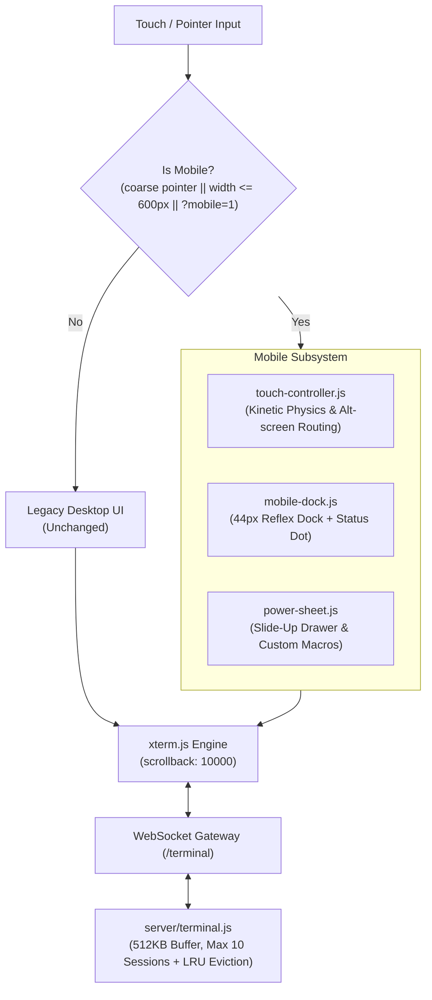

# Conduit Mobile Experience Redesign Specification

## 1. Executive Summary

This document specifies the architecture, component design, interaction physics, and verification plan for overhauling Conduit's mobile phone webapp experience. 

The primary goals are:
1. Eliminating the sluggish, high-resistance touch scrolling on Android/iOS mobile browsers via a dedicated kinetic momentum physics engine.
2. Resolving touch-selection fighting (`user-select: none` during normal pan + dedicated 500ms long-press Copy Mode).
3. Replacing the crammed 11-button desktop toolbar with a thumb-friendly **44px Micro-Dock** (5 buttons) and a pull-up **Power Sheet** containing navigation D-pad, symbol palette, customizable macros, and session controls.
4. Expanding backend scrollback buffering from 50KB to **512KB** with clean `term.reset()` replay and relative bottom-offset scroll restoration on mobile reconnection.
5. Preserving the desktop experience untouched by activating mobile enhancements only on coarse-pointer/narrow viewports or via the `?mobile=1` feature flag.

---

## 2. Decision Log

| Date | Topic | Decision | Alternatives Considered | Rationale |
| :--- | :--- | :--- | :--- | :--- |
| 2026-11-08 | **UI Architecture Model** | Option 1: Modular Vanilla Client | Monolithic `terminal.js` or Preact/Alpine framework | Zero build-step dependencies; strict separation of concerns; guarantees 60fps touch handling without virtual DOM overhead. |
| 2026-11-08 | **TUI & Agentic AI Compatibility** | Raw PTY Stream + Mobile Shell Controls | Plain HTML chat bubbles (like Slack/Warp) | Agentic CLI tools (`agy`, `codex`, `claude`) and TUIs rely heavily on raw terminal coordinates, alternate screens, and inline overwrites. Flat chat bubbles break these tools. |
| 2026-11-08 | **Reflex vs. Drawer Keys** | Micro-Dock for 4 Reflex Keys + Drawer | All keys in drawer OR all 11 keys in fixed bar | Reflex keys (`Ctrl+C`, `Tab`, `Esc`, `Ctrl`) must be 1-tap accessible for emergency interrupts and fast autocompletion. History, symbols, and macros belong in the drawer. |
| 2026-11-08 | **Alt-Screen Touch Routing** | SGR / Arrow Sequence Translation | Standard buffer scroll | In alternate screen (`vim`, `htop`, `nano`), buffer scrolling does nothing. Translating drag into SGR wheel (when mouse tracking is on) or arrow keys (when off) makes TUIs naturally scrollable. |
| 2026-11-08 | **Scrollback Memory Capping** | 512KB Buffer + Max 10 Sessions with LRU Eviction | 50KB fixed OR unbounded heap storage | 512KB allows complete review of lengthy agentic outputs. Capping sessions at 10 and evicting idle/disconnected sessions protects memory. |
| 2026-11-08 | **Mobile Sheet Visual Style** | Solid `#161616` background with dim scrim | `backdrop-filter: blur(...)` | Backdrop-filter triggers severe GPU composite slowdowns and dropped frames on Android mobile devices. |
| 2026-11-08 | **Desktop Isolation** | Coarse-pointer / narrow-viewport detection + `?mobile=1` flag | Global replace for all screen sizes | Ensures desktop mouse/keyboard workflows remain 100% stable while validating the new mobile UI. |

---

## 3. System Architecture & Component Contracts



### 3.1 Gating & Activation
The mobile UI initializes if any of the following conditions evaluate to true:
1. URL parameter: `window.location.search.includes('mobile=1')`
2. Pointer media query: `window.matchMedia('(pointer: coarse)').matches`
3. Viewport width: `window.innerWidth <= 600`

Otherwise, Conduit defaults to the existing desktop layout.

---

### 3.2 `client/touch-controller.js`
* **Container Touch Setup**:
  * CSS: `touch-action: none; user-select: none; -webkit-user-select: none; -webkit-touch-callout: none;`
  * Listeners: `touchstart`, `touchmove`, `touchend`, `touchcancel` registered with `{ passive: false }`. Call `e.preventDefault()` to stop browser gesture competition.
* **Kinetic Momentum Physics**:
  * Track samples $(y, t)$ over a **rolling 100ms window**.
  * Velocity on release: $v = \frac{y_{\text{last}} - y_{\text{first}}}{t_{\text{last}} - t_{\text{first}}}$.
  * Friction factor: $0.94$. Run decay inside `requestAnimationFrame`.
  * **Fractional line accumulator**: Accumulate displacement $\Delta y / \text{lineHeight}$. Emit integer lines:
    $$\text{step} = \text{Math.trunc}(\text{accumulator})$$
    $$\text{accumulator} = \text{accumulator} - \text{step}$$
  * Halt threshold: Stop animation loop when $|v| < 0.01\text{ px/ms}$ or when a new `touchstart` is detected.
* **Buffer & Mode Routing**:
  * **Normal Buffer (`term.buffer.active.type === 'normal'`)**: Call `term.scrollLines(step)`.
  * **Alternate Buffer (`term.buffer.active.type === 'alternate'`)**:
    * **Mouse tracking active** (`term.modes.mouseTrackingMode !== 'none'`):
      * If SGR mouse mode is active (`CSI ? 1006 h`), emit SGR wheel escape codes (`\x1b[<64;...M` / `\x1b[<65;...M`).
      * Otherwise, dispatch a synthetic `WheelEvent` to `term.element` which xterm's internal mouse service auto-encodes to legacy formats.
    * **Mouse tracking inactive** (`term.modes.mouseTrackingMode === 'none'`):
      * Drag Down (scroll up): emit `term.modes.applicationCursorKeysMode ? '\x1bOA' : '\x1b[A'`.
      * Drag Up (scroll down): emit `term.modes.applicationCursorKeysMode ? '\x1bOB' : '\x1b[B'`.
* **Copy Mode v1**:
  * Start a 500ms timer on `touchstart`.
  * Cancel timer if finger moves $> 10\text{px}$.
  * On timer expiration: suppress `contextmenu`, invoke `navigator.vibrate(50)` (if supported), freeze scrolling, trigger `term.select(col, row, wordLength)`, and display a floating `[ Copy ] [ Cancel ]` pill.

---

### 3.3 `client/mobile-dock.js`
* **Height**: Exactly **44px** (matches iOS/Android accessibility standards).
* **Positioning**: Fixed to bottom using `window.visualViewport` + `env(safe-area-inset-bottom)`.
* **Virtual Keyboard Protection**:
  * All buttons register `pointerdown` with `e.preventDefault()` to retain focus on xterm's hidden input textarea, preventing the Android keyboard from auto-closing on tap.
* **Buttons (5 Total)**:
  1. `[ ESC ]`: Sends `\x1b`.
  2. `[ TAB ]`: Sends `\t`.
  3. `[ CTRL ]`: Sticky modifier state machine:
     * *Single tap*: `ctrlActive = true`. Highlight amber. Converts the very next alpha keystroke to control code via `String.fromCharCode(code & 0x1f)`. Auto-clears.
     * *Double tap (<300ms)*: Locks sticky CTRL (solid amber glow). Remains locked until tapped a 3rd time.
  4. `[ ^C ]`: Sends `\x03` immediately.
  5. `[ ≡ ]`: Drawer button containing the **Connection Status Dot** (🟢 connected, 🟡 reconnecting, 🔴 disconnected).
* **Swipe-Up Gesture**: Dragging upward from the dock ($\Delta y < -30\text{px}$) triggers the Power Sheet.

---

### 3.4 `client/power-sheet.js`
* **Visuals**: Solid background `#161616`, border `#2b2b2b`, semi-transparent backdrop scrim (`rgba(0, 0, 0, 0.6)`). Smooth CSS transform slide-up animation.
* **Sections**:
  1. **Navigation D-Pad**:
     * Arrows: `↑` (`\x1b[A`), `↓` (`\x1b[B`), `←` (`\x1b[D`), `→` (`\x1b[C`).
     * History search: `Ctrl+R` (`\x12`).
     * Clear screen: `Ctrl+L` (`\x0c`).
  2. **Shell Symbol Strip**:
     * Quick-insert buttons for characters difficult to type on mobile keyboards: `|`, `~`, `/`, `-`, `_`, `$`, `&`, `>`, `;`, `{`, `}`.
  3. **User-Defined Macros**:
     * Reads from `localStorage['conduit_macros']`.
     * Preloaded defaults: `git status\n`, `docker ps\n`, `npm test\n`.
     * Users can add new macros or delete existing ones directly from the UI.
  4. **Session Controls**:
     * Shell switcher dropdown (`bash`, `zsh`, `cmd`, `powershell`).
     * Action buttons: `[ Copy Mode ]`, `[ Reconnect ]`, and `[ Logout ]`.

---

### 3.5 `client/terminal.js` Core Updates
* **Scrollback**: Configure `new Terminal({ scrollback: 10000, ... })`.
* **Reconnection & Scroll Offset Math**:
  ```javascript
  // Before reconnect replay:
  const wasAtBottom = (term.buffer.active.viewportY === term.buffer.active.baseY);
  const bottomOffset = Math.max(0, term.buffer.active.baseY - term.buffer.active.viewportY);

  // Clear corrupted escape state
  term.reset();

  // Replay server 512KB scrollback buffer
  term.write(replayedBuffer, () => {
    if (wasAtBottom) {
      term.scrollToBottom();
    } else {
      const targetY = Math.max(0, term.buffer.active.baseY - bottomOffset);
      term.scrollToLine(targetY);
    }
  });
  ```
* **Lifecycle Listeners**:
  * `document.addEventListener('visibilitychange')`: When `document.visibilityState === 'visible'`, verify WebSocket state; reconnect immediately if stale.
  * `window.addEventListener('online')`: Trigger instant reconnection check.
  * Exponential backoff: Base delay 2s, 4s, 8s, 16s, capped at 30s. If server returns a session-cap rejection (HTTP 429 / code 4002), halt retry loop and display `"Session limit reached. Close another tab."`.

---

### 3.6 `server/terminal.js` Updates
* **Scrollback Expansion**: `const MAX_BUFFER_LENGTH = 512 * 1024; // 512KB`.
* **Session Capping & LRU Eviction**:
  * Maximum concurrent sessions: `MAX_SESSIONS = 10`.
  * Track `lastActiveTime` on every incoming/outgoing packet.
  * When a new connection arrives and `activeSessions.size >= MAX_SESSIONS`:
    1. Scan for disconnected sessions (`!session.ws` or disconnect timeout active).
    2. If found, evict the oldest disconnected session (call `cleanupSession(id)`).
    3. If all 10 sessions are actively connected, reject the incoming connection with close code `4002` and message `"Server session capacity full"`.

---

## 4. Verification & Testing Matrix

### 4.1 Automated Unit & Integration Tests
* [ ] **Kinetic Accumulator Unit Test**: Test fractional line accumulation math across arbitrary delta inputs.
* [ ] **Sticky CTRL Unit Test**: Verify single-tap, double-tap lock, and `code & 0x1f` mapping.
* [ ] **Cursor Key Mode Test**: Verify correct emission of `\x1bOA` vs `\x1b[A` based on `term.modes.applicationCursorKeysMode`.
* [ ] **512KB Replay Integration Test**: Send 512KB payload; verify PTY reconnection delivers complete buffer without truncation.
* [ ] **Session Cap Integration Test**: Open 10 active connections; verify 11th connection is cleanly rejected. Disconnect one; verify 11th connection replaces the idle session.

### 4.2 Real-Device Mobile Test Matrix (Android & iOS Safari)
* [ ] **Kinetic Scroll Glide**: Flick 2,000 lines of scrollback; verify 60fps decay via Chrome Remote DevTools Performance profile.
* [ ] **Alt-Screen Paging in `nano` / `less`**: Verify drag moves pages up/down via application cursor keys.
* [ ] **Alt-Screen Wheel in `htop`**: Verify drag scrolls processes without exit or screen corruption.
* [ ] **Keyboard Retention**: Open Android Gboard / iOS keyboard; tap `TAB`, `ESC`, and `CTRL`; verify virtual keyboard does NOT dismiss.
* [ ] **Long-Press Copy Mode**: Long-press on a word for 500ms; verify selection highlights and floating copy pill appears without Android native text selection interference.
* [ ] **Wake-After-Lock Reconnection**: Lock phone screen for 2 minutes; unlock; verify socket auto-reconnects, `term.reset()` cleans state, and scroll offset relative to bottom is preserved.
